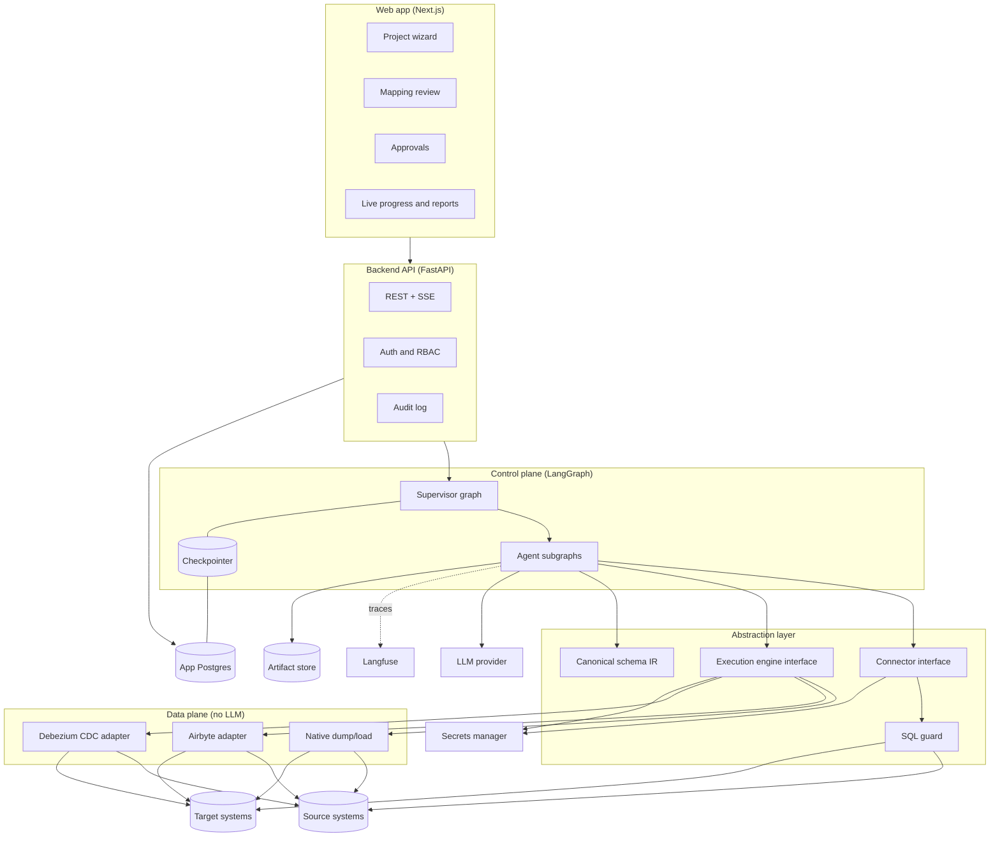
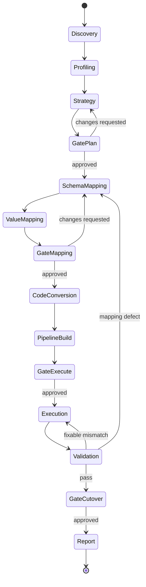
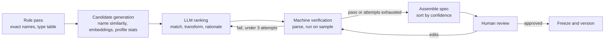

# Architecture: Agentic Data Migration Platform

Status: draft v0.1. Nothing here is implemented yet.

Assumed first path: MySQL → PostgreSQL with a deliberately different target schema, executed by native dump/load. Everything else is reached through the same interfaces later.

## 1. Design principles

1. **Agents plan, engines move.** LLM agents produce artifacts (inventory, mapping spec, DDL, job config, validation queries). Deterministic engines move the data. No row ever passes through an LLM on its way to the target.
2. **The mapping spec is the single source of truth.** DDL, pipeline config and validation queries are all generated from the approved spec, never written separately.
3. **Agnostic through interfaces, not through generality.** Agents see three contracts only: `Connector`, `ExecutionEngine`, and the canonical schema model (IR). Adding a database or a tool means adding an adapter, not touching an agent.
4. **Verify by execution.** Anything an LLM produces that can be executed (SQL, transforms, DDL) is parsed and run against a sample before a human sees it.
5. **Humans approve what cannot be undone.** Mapping freeze, target DDL, load start and cutover are approval gates.
6. **Everything is resumable.** A migration runs for hours or days. Every step is checkpointed and idempotent.

## 2. System overview



| Layer | Responsibility | Never does |
|---|---|---|
| Web app | Collect input, show artifacts, capture approvals | Talk to source/target directly |
| API | Auth, project CRUD, start/resume runs, stream events | Run long jobs in-request |
| Control plane | Decide what happens next, call agents, pause for humans | Move data |
| Abstraction layer | Hide databases and tools behind fixed contracts | Contain business logic |
| Data plane | Extract, load, replicate | Call an LLM |

## 3. Agent architecture

### 3.1 Supervisor graph

The supervisor is a phase state machine, not a free-form "pick the next agent" LLM router. Routing is code. An LLM is only consulted inside agents.



`Gate*` states are human approvals implemented with LangGraph `interrupt()`. The run is parked in the checkpointer until the API resumes it.

### 3.2 Shared state

One typed state object flows through the supervisor. It holds references, not payloads; large artifacts live in the artifact store.

```python
class MigrationState(TypedDict):
    migration_id: str
    phase: str
    source_ref: str            # connection id, never credentials
    target_ref: str
    inventory_uri: str | None
    profile_uri: str | None
    plan_uri: str | None
    mapping_spec_uri: str | None
    mapping_spec_version: int
    ddl_uri: str | None
    job_ids: list[str]
    validation_uri: str | None
    approvals: list[Approval]
    errors: list[AgentError]
```

### 3.3 Agents

| # | Agent | Input | Output artifact | LLM used for | Gate after |
|---|---|---|---|---|---|
| 0 | Supervisor | Events, approvals | State transitions | Nothing | — |
| 1 | Discovery | Connection ref | Inventory (IR) | Summarising, guessing table purpose | — |
| 2 | Profiling | Inventory | Data quality report, PII flags | Classifying columns, explaining issues | — |
| 3 | Strategy | Inventory, profile, downtime budget | Migration plan, wave order, risks | Reasoning over trade-offs | Plan |
| 4a | Schema mapper | Source IR, target IR, profile | Mapping spec (entity, attribute, type, transform, keys) | Ranking candidates, writing transforms | — |
| 4b | Value mapper | Distinct values from profile | Code/enum mapping tables | Suggesting value matches | Mapping |
| 5 | Code conversion | Views, procedures, triggers | Converted objects with confidence flags | Dialect translation | — |
| 6 | Pipeline builder | Frozen spec, plan, engine capabilities | Engine job config, load order | Little; mostly templating | Execute |
| 7 | Execution monitor | Job config | Run status, failure diagnosis | Error triage only | — |
| 8 | Validation | Frozen spec, source, target | Reconciliation report | Explaining mismatches | Cutover |

Per-agent notes:

- **Discovery** is mostly introspection code. It fans out per schema and writes the inventory in IR form. Dependencies (FKs, views, procedure references) become a graph used later for load order.
- **Profiling** runs bounded, sampled queries: null rate, distinct count, min/max, length distribution, pattern frequency, orphan FK checks. Output is statistics. Raw values only leave the database masked.
- **Strategy** chooses big bang vs phased vs CDC from size, downtime budget and engine capabilities. It produces estimates with stated assumptions and a rollback approach.
- **Schema mapper** is described in 3.4.
- **Value mapper** always requires human sign-off. Code meanings are business knowledge and cannot be verified by execution.
- **Code conversion** tries `sqlglot` transpilation first, LLM second, and marks anything it could not test as unverified.
- **Pipeline builder** asks the engine adapter what it supports and emits config for that engine. It is the only agent that knows which engine was chosen.
- **Execution monitor** is a polling loop with retries. It calls an LLM only to turn an engine error into a probable cause and a suggested fix.
- **Validation** generates checks from the spec: row counts, per-column aggregates, hash comparison on key ranges, FK integrity, and transform spot checks. It classifies each failure as load defect, mapping defect or source data defect, which decides where the supervisor routes back to.

### 3.4 Schema mapper subgraph



Table-level work is fanned out in parallel. Verification checks truncation, NOT NULL violations, uniqueness loss and cast failures on sampled data.

Mapping spec record:

```yaml
- target: customers.full_name
  sources: [cust_mst.fname, cust_mst.lname]
  kind: derived            # direct | derived | constant | lookup | dropped
  transform: "TRIM(CONCAT(fname, ' ', lname))"
  target_type: VARCHAR(120)
  null_handling: "use fname alone when lname is NULL"
  confidence: 0.82
  verified: true
  rationale: "name pattern and sample shapes"
  status: pending_review   # pending_review | approved | edited | rejected
```

## 4. Abstraction layer

### 4.1 Connector

```python
class Connector(Protocol):
    def capabilities(self) -> Capabilities: ...     # cdc, snapshots, parallel read
    def introspect(self) -> SchemaIR: ...
    def profile(self, table: str, spec: ProfileSpec) -> TableProfile: ...
    def sample(self, table: str, n: int, mask: MaskPolicy) -> Rows: ...
    def query(self, sql: str, mode: Literal["read", "ddl"]) -> Result: ...
    def dialect(self) -> str: ...
```

### 4.2 Canonical schema IR

A neutral model of tables, columns, logical types, constraints, indexes, views and routines. Source types are mapped into logical types (`integer(64)`, `decimal(p,s)`, `string(n)`, `timestamp(tz)`) on the way in and out to target types on the way out. Agents reason over the IR only.

### 4.3 Execution engine

```python
class ExecutionEngine(Protocol):
    def capabilities(self) -> EngineCapabilities: ...
    def plan(self, spec: MappingSpec, order: LoadOrder) -> JobConfig: ...
    def submit(self, job: JobConfig) -> str: ...
    def status(self, job_id: str) -> JobStatus: ...
    def cancel(self, job_id: str) -> None: ...
```

Adapters in order of implementation: native dump/load, Airbyte, Debezium.

### 4.4 SQL guard

Every statement an agent wants to run goes through one choke point:

- Parsed with `sqlglot`; unparseable SQL is rejected.
- Source connections accept `SELECT` only, with row and time limits.
- Target DDL requires an approval id tied to the frozen spec version.
- No `DROP`, `TRUNCATE` or unbounded `DELETE` from agents at all.
- Every statement is written to the audit log with the agent and trace id.

## 5. Platform components

| Component | Choice | Why |
|---|---|---|
| Frontend | Next.js + TypeScript | Review-heavy UI, streaming updates |
| API | FastAPI | Same language as LangGraph |
| Orchestration | LangGraph | Checkpointing, interrupts, parallel fan-out |
| Workers | Separate worker process pulling runs from a queue | Runs outlive HTTP requests |
| App database | PostgreSQL | Projects, artifacts index, approvals, audit, checkpoints |
| Artifact store | S3-compatible (MinIO locally) | Inventories, specs, reports |
| Secrets | Cloud secret manager or Vault; env file locally | Credentials stay out of state and prompts |
| Tracing and evals | Langfuse | Traces, prompt versions, cost, datasets |
| LLM access | Provider-neutral chat model wrapper, model per agent in config | Swap providers without code changes |

### Data model (app database)

| Table | Holds |
|---|---|
| `projects` | Name, owner, source/target connection refs |
| `connections` | Type, host metadata, secret reference |
| `migrations` | One run: phase, status, thread id |
| `artifacts` | Type, version, URI, producing agent, trace id |
| `mapping_records` | Spec rows for review and editing |
| `approvals` | Gate, approver, decision, spec version, time |
| `jobs` | Engine, config URI, status, metrics |
| `audit_log` | Every executed statement and state change |

## 6. Security

- Credentials are resolved inside connector and engine adapters at call time. Agent state and prompts carry only a connection id.
- Source uses a read-only database user.
- LLM prompts contain schema and statistics. Samples are masked by the connector before any agent receives them.
- PII flags from profiling tighten masking for the rest of the run.
- Roles: viewer, operator (run and review), approver (pass gates), admin.
- Audit log is append-only.

## 7. Observability and evaluation (Langfuse)

- One trace per agent invocation, tagged with `migration_id`, agent name and spec version.
- Prompts are versioned in Langfuse and referenced by name from code.
- Cost and latency are reported per migration and per agent.
- Golden datasets: schema pairs with hand-written correct mappings.
- Scores tracked per prompt or model change:
  - column match precision and recall
  - transform correctness, judged by executing the transform against expected output
  - count of wrong mappings with confidence above 0.8
  - share of mappings a human had to edit

Exact SDK calls for LangGraph and Langfuse should be taken from their current documentation at implementation time.

## 8. Deployment

Local and first deployment are a single `docker compose` file: web, api, worker, app Postgres, MinIO, Langfuse, plus sample MySQL and Postgres databases for testing. Workers must be able to reach source and target networks; for customer environments later, the worker and connectors run inside the customer network and the control plane stays hosted.

## 9. Repository layout

```
apps/
  web/                 Next.js UI
  api/                 FastAPI service
platform/
  graph/               supervisor graph, state, gates
  agents/              one package per agent
  connectors/          base protocol + mysql/, postgres/
  engines/             base protocol + native/
  ir/                  canonical schema model, type maps
  guard/               SQL guard
  specs/               mapping spec model and generators (DDL, validation)
evals/                 golden datasets and eval runners
samples/               sample source and target schemas with seed data
deploy/                docker compose
docs/
```

## 10. Build phases

| Phase | Scope | Done when |
|---|---|---|
| 1 | IR, MySQL and Postgres connectors, SQL guard, Supervisor, Discovery, Schema mapper, native engine, Validation, minimal review UI, tracing | Sample database migrates end to end with a human approving the mapping |
| 2 | Profiling, Value mapper, Strategy, eval datasets | Mapping quality is measured on every prompt change |
| 3 | Code conversion, Pipeline builder, Airbyte adapter | A second engine runs the same frozen spec |
| 4 | Debezium CDC, cutover gate, reverse sync | Zero-downtime migration of the sample database |
| 5 | Multi-user, RBAC, more connectors | Second team can use it without help |

## 11. Open decisions

1. First source/target pair. This document assumes MySQL → PostgreSQL.
2. Whether the target schema is always supplied by the user or can be proposed by an agent.
3. Queue technology for workers.
4. Hosting model: fully hosted, or hosted control plane with in-network workers.
